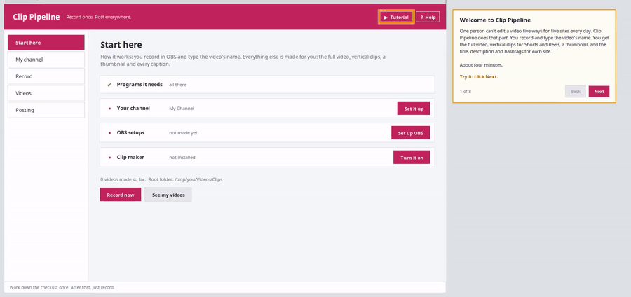
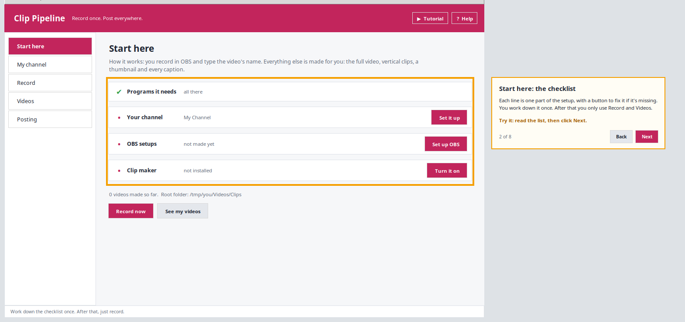
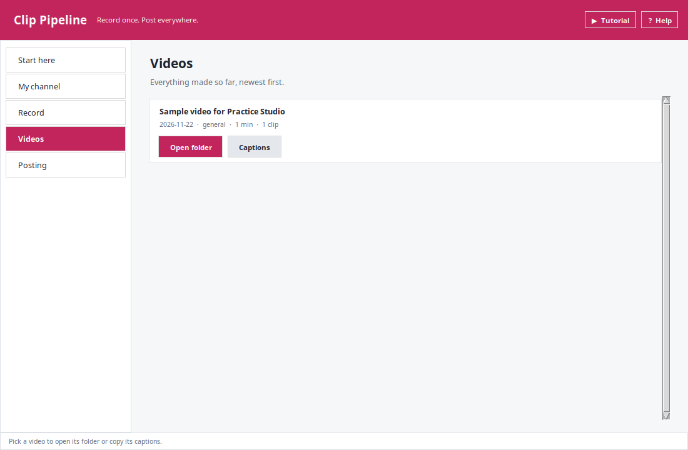
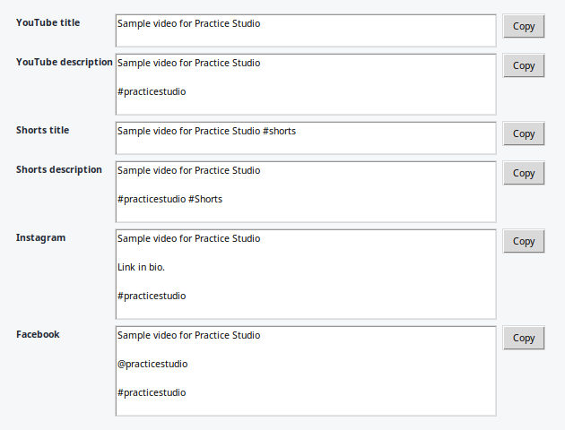
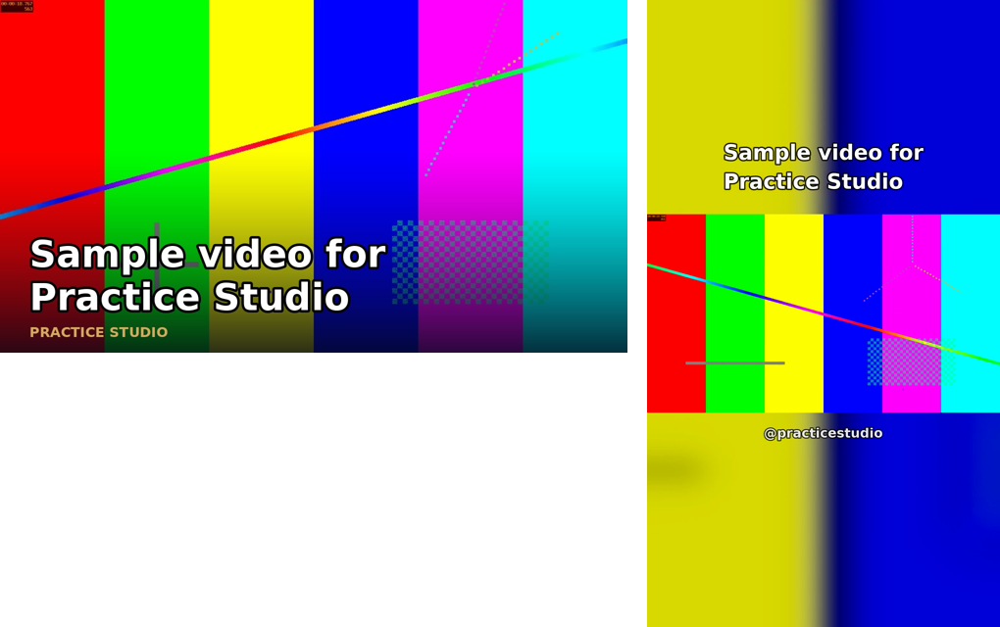

# Clip Pipeline

**Record once. Get the full video, vertical clips, a thumbnail and every caption, made for you.**

You record in OBS and type the video's name. The pipeline makes:
- **the full video**, untouched, for YouTube
- **vertical 1080×1920 clips** for YouTube Shorts, Instagram Reels and Facebook Reels: your picture over a blurred copy of itself, with the title on top and your @handle below
- **a thumbnail** with the title on it
- **every title, description, caption and hashtag**, written for each site
- **a status spreadsheet** showing what's ready, what's scheduled, what's posted and what needs you

If you want, it can also schedule one clip a day per site through [Buffer](https://buffer.com). That stays off until you turn it on.

Linux (X11). Free and open source.



*The tutorial ends by turning a sample video into clips, so you see the result before you record anything. ([Full video](docs/tutorial.mp4))*

---

## Why this exists

A small studio, or one person, wants to show its work: reading sessions, games, how-tos on screen. The audience is split across YouTube, Shorts, Instagram, Facebook and more, and each wants something different: a long video here, a vertical 58-second clip there, a different caption length and a different set of hashtags everywhere.

Doing that by hand for every recording means, every time:
1. Open an editor.
2. Cut the clips.
3. Reframe them to vertical.
4. Add the title and your handle.
5. Export each one.
6. Make a thumbnail.
7. Write five captions.
8. Upload to each site.

That's an hour or more per video, and it's the hour that makes people stop posting.

We wanted the only human step to be the part a human has to do: **record, and say what the video is called.** Everything after that is the same every time, so a computer should do it. That's this pipeline. It's the one we use for our own channel, with our names taken out and yours put in.

## What it can replace

Clip Pipeline is built to be a free, local alternative to the paid tools most creators stack together.

| If you use… | It's good at… | What Clip Pipeline does instead |
|---|---|---|
| **Opus Clip** and other AI clippers | Picking the "best" moments with AI | You upload your video and pay per minute or monthly. Here everything runs on your computer for free. It takes clips at even spacing rather than guessing at highlights (see Limits). |
| **CapCut, Descript** | Hand editing, captions, effects | Great when you want to craft one video. For the same vertical format every day, hand editing is the bottleneck. Here it happens with no clicks at all. |
| **Canva** | Thumbnails and graphics | Here a thumbnail with your title is made for every video, in the same style every time. |
| **Hootsuite, Later** and other social suites | Scheduling and analytics for teams | They cost a monthly fee per seat. Here you write no captions and schedule nothing by hand. The posting step uses Buffer's free plan, or you post yourself with the captions it wrote. |
| **Copying captions into five apps** | Free | It wrote them already. On the **Videos** page, each one is a click from your clipboard. |

## Why it works the way it does

- **The name is the only input.** When OBS stops, a box asks "What's this video called?". The title becomes the file name, the thumbnail text, the clip titles and the captions.
- **Kinds instead of settings.** Gameplay, reading and screen videos need different clips (a reading session is quiet and long, so it gets a time-lapse). Pick the kind by where you record, and the wording follows.
- **Blurred background, not black bars.** A wide video in a tall frame looks deliberate when the empty space is a blurred copy of the picture.
- **Never in the way.** Encoding runs at the lowest priority and waits while OBS is recording, so the game you're recording never stutters.
- **Posting is off until you say so.** A pipeline that posts by surprise is worse than none. Everything waits in `ready/` until you turn posting on.
- **A scheduler, not raw APIs.** See *Posting* below.

## How it flows

```
OBS stops recording
  → watch.sh sees the new file and asks "What's this video called?"
  → process.py: full.mp4 + short_01.mp4 … + thumb.jpg + post.json in <root>/ready/<date>_<kind>_<name>/
  → status.py rebuilds Posting.xlsx
  → post.py (when posting is on): hosts each clip, schedules it in Buffer, checks what went out, cleans up
```

## Kinds of video

A recording dropped in `recordings/<kind>/` is handled as that kind. Each kind gets its own clips and wording.

| Kind | OBS setup | Clips |
|---|---|---|
| `gameplay` | whole screen + desktop sound, no mic | up to 6 clips of 58 s each, spread evenly through the video |
| `reading` | camera over a banner, silent | the whole sitting sped up to ~45 s, plus 45 s in real time |
| `screen` | whole screen + small camera + desktop sound | up to 4 clips of 58 s each |
| anything else | | handled as `general` |

Encoding runs at the lowest priority and waits while OBS is recording, so a game you're recording never stutters.

## The app

```
python3 clip_pipeline_app.py
```

The first time, a **tutorial** runs by itself:
1. Walk through the checklist.
2. Type your channel's name.
3. See the three kinds of video.
4. Make clips from a 75-second sample video, so you see exactly what you get before you record anything.

The **▶ Tutorial** button runs it again, and **F1** explains any page.

The app has five pages:
- **Start here:** a checklist of the setup, with a button to fix each missing part. It covers the programs it needs, your channel, the OBS setups and the background clip maker.
- **My channel:** your name, @handle, links and hashtag.
- **Record:** opens OBS on the right setup for gameplay, reading or screen videos. You can also make clips from a video you already have.
- **Videos:** everything made so far, with the folder one click away and every caption ready to copy.
- **Posting:** Buffer settings, an on/hold switch, and check or post now.

## Set up by hand

```
git clone https://github.com/sebaytlabs/clip-pipeline ~/clip-pipeline
cd ~/clip-pipeline
mkdir -p ~/.config/clip-pipeline
cp config.example.json ~/.config/clip-pipeline/config.json     # then put your name, handle and links in it
chmod 600 ~/.config/clip-pipeline/config.json

python3 banner/make_banner.py && python3 banner/make_frame.py  # the reading-session banner, with your name
python3 obs/setup_obs.py --encoder x264                        # close OBS first; qsv (Intel) or nvenc (NVIDIA) if you have them
cp systemd/clip-watch.service ~/.config/systemd/user/
systemctl --user daemon-reload && systemctl --user enable --now clip-watch.service
```

Now **Record Gameplay**, **Record Reading** and **Record Screen** are in your app menu. Each opens OBS on the right setup.

### Make it yours

- **Wording:** all of it lives in `templates.py`, one function per kind. Change it there.
- **Brand details** come from `config.json`: channel name, @handle, YouTube link, site, the one link you want clicked, and your own hashtag.

## Posting (optional)

Posting straight from your own code is harder than it looks. YouTube's documentation says videos uploaded through its API by unaudited apps are made private until Google audits the app, and Meta's publishing APIs need app review. A scheduling service that already has those approvals avoids both. Check the current rules yourself, because they change. Buffer's free plan covers three channels and ten scheduled posts per channel.

To set it up:
1. In Buffer, connect YouTube, Instagram and your Facebook Page, then make an API key (Settings > API).
2. Put the key and the three channel ids in `config.json`.
3. Pick hosting: Buffer fetches each clip from a public address, and the clip is removed again once every site has posted it.
   - `{"type": "folder", "folder": "/var/www/clips", "base_url": "https://you.com/clips"}` if you have a web server, or
   - `{"type": "shopify", ...}` to use a Shopify store's Files. This needs a custom app with only `read_files` and `write_files`.
4. Set `"posting": "on"`, then run `python3 post.py` once a day (a cron job or a systemd timer).

`python3 post.py --check` only refreshes the status of what's already scheduled. Upload the full video to YouTube yourself; Buffer only takes short videos.

## Tests

```
python3 -m unittest discover tests
python3 templates.py          # prints every kind's texts so you can read them
```

## Screenshots


*Start here: the setup checklist, with a button for each missing part.*


*Videos: everything made, newest first.*


*Captions for each site, one click to copy.*


*What the sample video became: the thumbnail, and a frame from the vertical clip.*

## Related tools

- **[Drive Kit](https://github.com/sebaytlabs/drive-kit).** Back up your recordings to a second drive. Its `record.sh` is a lighter screen recorder when you don't need OBS.
- **[Transcribe Folder](https://github.com/sebaytlabs/transcribe-folder).** Turn your videos' speech into text, for show notes, captions or blog posts.
- **[Learning Kit](https://github.com/sebaytlabs/learning-kit).** The reading kind exists because we record our reading sessions.

## Limits, plainly

- **Clips are evenly spaced, not chosen.** A 30-minute game gives up to six clips spread across it. Some will be better than others. Make clips by hand from a file when one moment matters.
- **Linux with X11** for the recorder and the watcher. The clip maker itself (`process.py`) only needs ffmpeg and Python, and works anywhere.
- **Posting needs Buffer** and somewhere public to host each clip briefly (a web folder or a Shopify store's Files). Without that, you post yourself using the captions it wrote.
- **Platform rules change.** Clip lengths, caption limits and API rules are current as of 2026. Check them before you rely on them.

## License

MIT. Made by [Sebayt Labs](https://sebaytlabs.com). We build free tools when the usual ones are too expensive, too complicated, or don't do the job.
